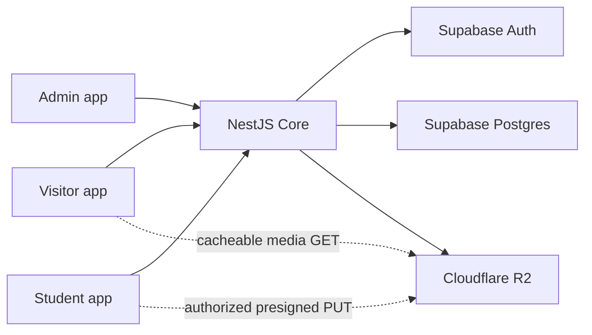

# Architecture

## System boundary

Core is both domain API and authentication BFF. Frontends may render and proxy transport concerns, but they do not own authorization or query Supabase tables. The only direct browser-to-provider traffic is an R2 operation authorized by a short-lived, operation-specific presigned URL from Core.

## Deployable surfaces

Each `apps/*` workspace is independently deployable, health-checked, and horizontally scalable. Services do not rely on local disk or in-memory session affinity. Coolify routes four subdomains to four containers.

| Surface | Public exposure                           | Stateful dependency | Health                                |
| ------- | ----------------------------------------- | ------------------- | ------------------------------------- |
| Visitor | internet                                  | Core                | `/health`                             |
| Admin   | internet, authentication required         | Core                | `/health`                             |
| Student | internet, authentication required         | Core                | `/health`                             |
| Core    | internet through controlled origin policy | Supabase, R2        | `/v1/health/live`, `/v1/health/ready` |

## Authentication flow

1. Student submits Student ID and password to Core over TLS.
2. Core maps Student ID to a private synthetic Supabase Auth identity.
3. Core establishes Secure, HttpOnly session cookies with an explicit subdomain policy.
4. Guards resolve Account and role from server-owned session state. Request bodies never choose actor identity.
5. A newly provisioned Account remains restricted to password change until the forced-change requirement is cleared.

Admin uses the same Core/Supabase boundary. Public profile identifiers are random and unrelated to Student ID or Supabase identity IDs.

## Work publication model

A Work is the stable aggregate. Revisions are immutable review candidates. Approval advances the Published Revision pointer atomically; it does not overwrite history. If an approved Work is edited, the old Published Revision remains visible while the new Revision is reviewed.

Contributor attribution is invitation-based. The Submitter alone edits and submits. Study Year is recorded on each Work attribution because it describes historical contribution, not current Student state.

## Scale assumptions

- Cursor pagination for unbounded public and admin collections.
- Database indexes follow real filter and ordering paths; migrations include query-plan evidence for high-volume paths.
- Public catalog responses and media are cacheable only after publication and consent filters.
- Search starts with indexed Postgres capabilities; introduce a separate search system only after measured need.
- Services remain stateless so Coolify can add replicas behind the same route.
- Background work must be idempotent and observable before it is moved out of request handling.

## Architecture changes

Cross-boundary decisions require an ADR. Domain vocabulary changes update `CONTEXT.md` in the same pull request.
