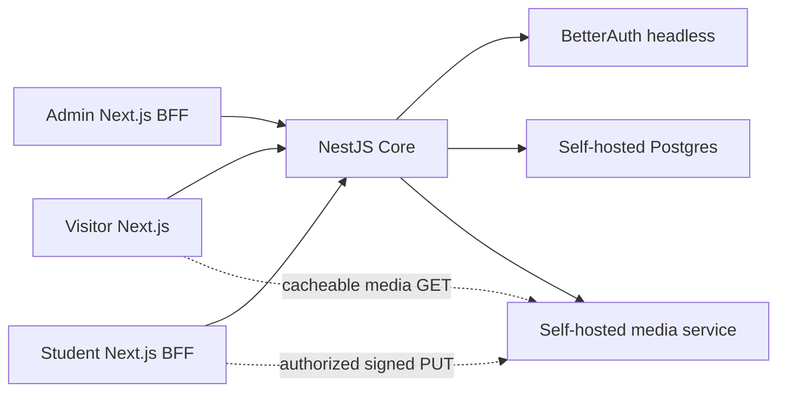

# Architecture

## System boundary

Core is the authoritative domain API and authentication service. Authenticated Next.js frontends are browser-facing BFFs: Server Components perform reads, Server Actions perform mutations, and host-only cookies never leave their frontend hostname. Frontends do not query the database. Media operations use short-lived HMAC-signed URLs issued by Core and validated by the dedicated storage service.

## Deployable surfaces

Each `apps/*` workspace is independently deployable, health-checked, and horizontally scalable. Services do not rely on local disk or in-memory session affinity. Coolify routes four subdomains to four containers.

| Surface | Public exposure                                 | Stateful dependency | Health                                |
| ------- | ----------------------------------------------- | ------------------- | ------------------------------------- |
| Visitor | internet                                        | Core                | `/health`                             |
| Admin   | internet, authentication required               | Core                | `/health`                             |
| Student | internet, authentication required               | Core                | `/health`                             |
| Core    | internal endpoints plus controlled public reads | self-hosted Postgres, BetterAuth, media service | `/v1/health/live`, `/v1/health/ready` |

## Authentication flow

1. An Admin or Student submits private login data to a Server Action on the matching frontend over TLS.
2. The frontend validates input and calls its audience-specific, BFF-authenticated internal Core endpoint through `@showcase/core-client`.
3. Core maps the private login identifier to a private synthetic BetterAuth identity and creates an audience-bound authoritative session.
4. The frontend stores only the opaque session token in its own Secure, HttpOnly, host-only cookie. Admin and Student cookies and BFF secrets remain distinct.
5. Subsequent Server Components and Server Actions forward that token through the shared transport client. The client validates response contracts but owns no authorization policy.
6. Core guards resolve current Account, role, audience, forced-change, and access state. Request bodies never choose actor identity.
7. A newly provisioned Account remains restricted to password change until the forced-change requirement is cleared.

Public profile identifiers are random and unrelated to Student ID, Admin login, or BetterAuth identity IDs.

## Work publication model

A Work is the stable aggregate. Revisions are immutable review candidates. Approval advances the Published Revision pointer atomically; it does not overwrite history. If an approved Work is edited, the old Published Revision remains visible while the new Revision is reviewed.

Contributor attribution is invitation-based. The Submitter alone edits and submits. Study Year is recorded on each Work attribution because it describes historical contribution, not current Student state.

## Scale assumptions

- Cursor pagination for unbounded public and admin collections.
- Database indexes follow real filter and ordering paths; migrations include query-plan evidence for high-volume paths.
- Public catalog responses and media are cacheable only after publication and consent filters.
- Search starts with indexed Postgres capabilities; introduce a separate search system only after measured need.
- Services remain stateless so Coolify can add replicas behind the same route.
- Background work must be idempotent and observable before it is moved out of request handling. Core records cache-invalidation intent in a durable outbox with the authoritative domain transition, then dispatches retry-safe derived effects asynchronously.

## Architecture changes

Cross-boundary decisions require an ADR. Domain vocabulary changes update `CONTEXT.md` in the same pull request.
