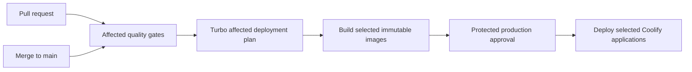

# CI and CD

## Pipeline

## Workflows

| File                 | Responsibility                                                                       |
| -------------------- | ------------------------------------------------------------------------------------ |
| `ci.yml`             | quality gates plus the trusted deployment-plan artifact for successful `main` pushes |
| `build-image.yml`    | reusable OCI build, SBOM, provenance, and GHCR push                                  |
| `deploy-coolify.yml` | pin immutable tag, trigger Coolify, and poll terminal status                         |
| `production.yml`     | build and deploy only applications named by the CI plan after production approval    |

CI checks out full Git history because Turbo affected calculation depends on the real push base and head. Formatting and delivery-workflow contract tests are repository-wide and cheap; application gates remain package-aware.

## Affected application plan

For a successful push to `main`, CI asks Turbo for `build` tasks affected since `github.event.before`. Turbo expands shared-package changes to dependent applications. `tools/ci/create-deployment-plan.mjs` filters that graph to the five deployable images: `core`, `admin`, `student`, `visitor`, and `media`. A first push with an unavailable base marks all five affected. A change with no deployable application impact produces an empty plan and no production build or deployment.

Repository files copied into every application build context are Turbo global dependencies. Changing one marks every deployable application affected. A Core image change deploys `core`, `core-cache-worker`, and `core-media-processor` because those three Coolify resources run the same image.

CI uploads the versioned JSON plan as a workflow artifact. The production workflow downloads it only from the successful triggering CI run, verifies its source SHA, and uses its matrix directly. This preserves the exact multi-commit push range that CI evaluated instead of guessing a parent commit in the later `workflow_run` event.

## Image contract

Image names are `ghcr.io/csi-spu/showcase-<app>:sha-<40-character-commit-sha>`. No moving tag participates in deployment. Each selected image includes the source SHA and is built as a non-root container with SBOM and provenance attestations.

The production workflow builds selected images once after CI. Runtime configuration belongs in Coolify except the three public Sentry browser DSNs accepted by ADR 0016. Those DSNs are baked into their matching frontend image; no private credential is a build argument.

Every production image build uploads source maps to its matching Sentry project before publishing the image. GitHub passes `SENTRY_AUTH_TOKEN` only as a BuildKit secret and passes the non-secret `SENTRY_ORG` variable separately. A missing configuration value or failed upload fails that image build. Release names use `showcase-<app>@<full-source-sha>`.

## Production deployment

The production workflow starts after successful `main` push CI, verifies the source commit belongs to `main`, builds the selected matrix, and then enters the protected `production` Environment approval gate. Media deploys first when selected, Core and its two workers follow when selected, then selected frontends deploy independently. A failed dependency prevents downstream deployment; an unrelated skipped application does not.

`workflow_dispatch` remains available for redeploying existing images. It requires a full `main` commit SHA and an exact JSON application list such as `["media"]`. The workflow validates the list, verifies only those immutable images exist, requests production approval, and deploys only those applications. It never rebuilds a manual source SHA.

Staging is intentionally not part of the current delivery path. Adding it later requires a new decision and an isolated Coolify environment; do not create a long-lived staging branch.

## Deployment contract

Coolify applications use the Docker Image resource type, with `docker_registry_image_name` configured once. The reusable workflow:

1. PATCHes `docker_registry_image_tag` to the immutable SHA tag.
2. POSTs `/api/v1/deploy` for the application UUID.
3. Polls `/api/v1/deployments/<deployment-uuid>`.
4. Succeeds only on `finished`; fails on terminal errors, unknown statuses, repeated API errors, or timeout.

CI never SSHes into the host. Coolify auto-deploy from Git and image-tag watching stay disabled so GitHub Actions is the only deployment coordinator.

Schema changes must remain backward-compatible with the running containers during rolling deployment. See `docs/rules/backward-compatibility.md`.
