# CI and CD

## Pipeline

```mermaid
flowchart LR
  PR[Pull request] --> CI[Affected lint, typecheck, tests, build]
  CI --> Main[Reviewed merge to main]
  Main --> Images[Build 4 SHA images in GHCR]
  Images --> StagingCore[Deploy Core staging]
  StagingCore --> StagingWeb[Deploy 3 frontends staging]
  StagingWeb --> Approval[Manual protected production approval]
  Approval --> ProdCore[Promote same Core image]
  ProdCore --> ProdWeb[Promote same frontend images]
```

## Workflows

| File                 | Responsibility                                                           |
| -------------------- | ------------------------------------------------------------------------ |
| `ci.yml`             | formatting plus affected package quality gates                           |
| `build-image.yml`    | reusable OCI build, SBOM, provenance, GHCR push                          |
| `deploy-coolify.yml` | pin immutable tag, trigger Coolify, poll terminal status                 |
| `staging.yml`        | run after successful main CI, build once, and guard staging deployment   |
| `production.yml`     | verify main SHA and existing images, require approval, promote unchanged |

CI checks out full Git history because Turbo affected calculation depends on the real base/head range. Formatting is repository-wide and cheap; application gates are package-aware.

## Image contract

Image names are `ghcr.io/csi-spu/showcase-<app>:sha-<40-character-commit-sha>`. No environment moving tag participates in a deployment. The image includes the source SHA and runs as a non-root user with a container health check.

Staging builds once. Production verifies all four tags already exist and deploys those same artifacts. Runtime configuration belongs in Coolify, and public frontend build variables are avoided.

## Staging provisioning guard

`COOLIFY_STAGING_ENABLED` is a non-secret repository variable. Missing or any value other than the exact string `true` keeps staging deployment jobs skipped while CI and immutable image builds continue. Enable it only after the staging Coolify applications, UUID variables, environment secrets, domains, and runtime configuration are complete.

Automated staging starts through `workflow_run` only after the `CI` workflow succeeds for a push to `main`. A failed or pull-request CI run never builds or deploys staging images.

For the first deployment after provisioning, run `Deploy staging` manually with the full main-branch SHA built by the initial push. The workflow verifies that the SHA belongs to `main` and that all four immutable images already exist; it does not rebuild or overwrite their tags.

## Deployment contract

Coolify applications use the Docker Image resource type, with `docker_registry_image_name` configured once. The reusable workflow:

1. PATCHes `docker_registry_image_tag` to the immutable SHA tag.
2. POSTs `/api/v1/deploy` for the application UUID.
3. Polls `/api/v1/deployments/<deployment-uuid>`.
4. Succeeds only on `finished`; fails on terminal errors, unknown statuses, repeated API errors, or timeout.

CI never SSHes into the host. Coolify auto-deploy from Git and image-tag watching stay disabled so GitHub Actions is the only deployment coordinator.

## Ordering and failure

All images must build before deployment begins. Core deploys first because every frontend depends on it. Frontends deploy in parallel after Core succeeds. A failed Core deploy stops frontend rollout. One failed frontend does not cancel the other frontend deployments, but the workflow remains failed.

Schema changes must obey backward compatibility so old and new containers can overlap during a rolling deployment. See `docs/rules/backward-compatibility.md`.
